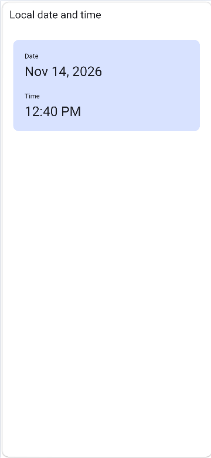
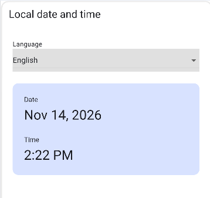
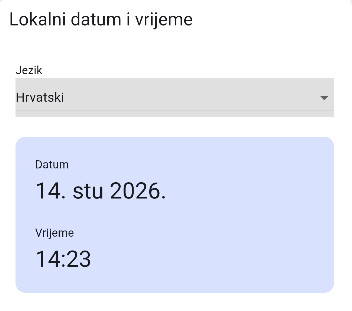
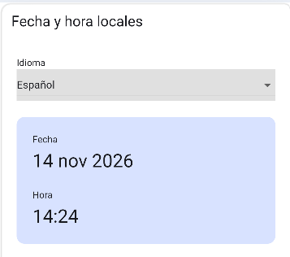
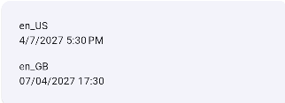
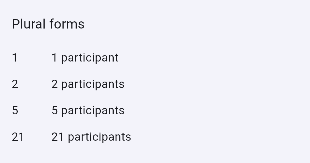
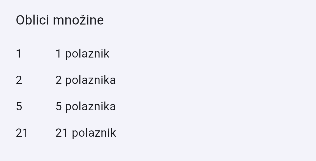
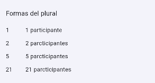

# Lokalizacija i internacionalizacija u Flutteru

Seminarski rad iz kolegija Razvoj aplikacija za mobilne i pametne uređaje.

Autor: Luka Petek

Aplikacija prikazuje kako u Flutteru dodati prijevode sučelja te prilagoditi prikaz datuma, vremena, množine, brojeva i valute. Na istom zaslonu može se odabrati engleski, hrvatski ili španjolski. Primjeri su dodavani redom, pa svaki commit prikazuje jedan korak izrade.

## Pokretanje

Potreban je Flutter SDK s podrškom za Dart 3.14 ili noviji iz serije 3.x te proizvoljan web preglednik (u mom slučaju Edge) za pokretanje web verzije.

Kloniraj repozitorij, otvori njegovu glavnu mapu u VS Codeu i u terminalu pokreni:

```powershell
flutter pub get
flutter gen-l10n
flutter run -d edge
```

`flutter pub get` dohvaća ovisnosti, a `flutter gen-l10n` iz ARB datoteka generira `AppLocalizations`.

## Primjeri

| # | Primjer | Što prikazuje | Glavne datoteke | Commit |
| --- | --- | --- | --- | --- |
| 1 | Lokalni datum i vrijeme | Očitavanje s uređaja i prikaz pomoću `MaterialLocalizations` | `workshop_page.dart` | [Pogledaj korak 1](https://github.com/lpetek24/flutter-lokalizacija-seminar/commit/bb9311481f2a4e34661922dc4b0209f2b9f7f011) |
| 2 | Prijevodi i odabir jezika | ARB prijevodi za `en`, `hr` i `es` te promjena `MaterialApp.locale` | `workshop_app.dart`, `workshop_page.dart`, `lib/l10n/` | [Pogledaj korak 2](https://github.com/lpetek24/flutter-lokalizacija-seminar/commit/7ffbe5d3d6eee7d80b973aeaa163f960f329eb8a) |
| 3 | Regionalni formati | Isti datum i vrijeme u formatima `en_US` i `en_GB` | `main.dart`, `regional_formats.dart` | [Pogledaj korak 3](https://github.com/lpetek24/flutter-lokalizacija-seminar/commit/b281b914170377e54174274adf24dfbb917e27c7) |
| 4 | Množina | Oblici poruka za 1, 2, 5 i 21 polaznika na tri jezika | `plural_examples.dart`, `lib/l10n/` | [Pogledaj korak 4](https://github.com/lpetek24/flutter-lokalizacija-seminar/commit/71283203b20052fd5f3dba30a86542c7193e31fb) |
| 5 | Brojevi i valuta | Prikaz iste vrijednosti kao običnog broja i iznosa u eurima | `number_formats.dart`, `lib/l10n/` | [Pogledaj korak 5](https://github.com/lpetek24/flutter-lokalizacija-seminar/commit/52350ad4b697c4b3e140ddc806958c2727c4bd35) |

## Tutorial

### 1. Lokalni datum i vrijeme

U `WorkshopPage.build()` očitaj lokalno vrijeme uređaja pomoću `DateTime.now()`. Iz `MaterialLocalizations.of(context)` dohvati pravila formatiranja pa pozovi `formatShortDate()` i `formatTimeOfDay()`. Prikaz se osvježava kad se zaslon ponovno izgradi.



### 2. Prijevodi i odabir jezika

1. U `pubspec.yaml` dodaj `flutter_localizations` i `intl` te uključi `generate: true` u sekciji `flutter`.
2. U `l10n.yaml` postavi `app_en.arb` kao predložak. U `lib/l10n/` dodaj hrvatsku i španjolsku datoteku s istim ključevima i prevedenim tekstovima.
3. Pokreni `flutter gen-l10n` i registriraj generirani `AppLocalizations.delegate` u `MaterialApp` uz Materialove delegate.
4. U `WorkshopPage` dohvati prijevode pomoću `AppLocalizations.of(context)`. Kad korisnik odabere drugi jezik, proslijedi novi `Locale` u `WorkshopApp` i ažuriraj ga pozivom `setState()`.

| English | Hrvatski | Español |
| --- | --- | --- |
|  |  |  |

### 3. Regionalni formati datuma i vremena

U `main()` pozovi `await initializeDateFormatting()` prije `runApp()`. U widgetu `RegionalFormats` formatiraj isti primjer, 7. travnja 2027. u 17:30, s oba localea.

```dart
final sample = DateTime(2027, 4, 7, 17, 30);
final usFormat = DateFormat.yMd('en_US').add_jm().format(sample);
final ukFormat = DateFormat.yMd('en_GB').add_jm().format(sample);
```

`yMd` traži godinu, mjesec i dan, a `add_jm()` dodaje sat i minute. Locale određuje njihov zapis. Rezultati su `4/7/2027 5:30 PM` i `07/04/2027 17:30`.



### 4. Množina u ARB-u

U ARB datoteke dodaj poruku `participantCount`. U engleskom predlošku definiraj `count` kao `int`, pa ponovno pokreni `flutter gen-l10n`. U widgetu `PluralExamples` pozovi `messages.participantCount(count)` za svaki broj u tablici.

```json
"participantCount": "{count, plural, one{{count} polaznik} few{{count} polaznika} other{{count} polaznika}}"
```

Za hrvatski `21` pripada kategoriji `one`, pa dobivamo `21 polaznik`. Za engleski isti broj pripada kategoriji `other`, pa dobivamo `21 participants`.

| English | Hrvatski | Español |
| --- | --- | --- |
|  |  |  |

### 5. Brojevi i valuta

U widgetu `NumberFormats` dohvati locale s `Localizations.localeOf(context).toLanguageTag()`. Predaj ga formaterima `NumberFormat.decimalPattern()` i `NumberFormat.currency()`.

```dart
const sample = 1234.56;
final number = NumberFormat.decimalPattern(locale).format(sample);
final amount = NumberFormat.currency(
  locale: locale,
  name: 'EUR',
  symbol: '€',
).format(sample);
```

Promjenom jezika mijenjaju se razdjelnici i položaj znaka eura. U oba prikaza vrijednost iznosa ostaje ista.

## Korišteni paketi i izvori

- [Flutter dokumentacija – Internationalizing Flutter apps](https://docs.flutter.dev/ui/internationalization)
- [intl – DateFormat](https://pub.dev/documentation/intl/latest/intl/DateFormat-class.html)
- [intl – NumberFormat](https://pub.dev/documentation/intl/latest/intl/NumberFormat-class.html)
- [Unicode CLDR – pravila množine po jezicima](https://unicode.org/cldr/charts/48/supplemental/language_plural_rules.html)
- [material_ui – Material komponente za Flutter](https://pub.dev/packages/material_ui)
